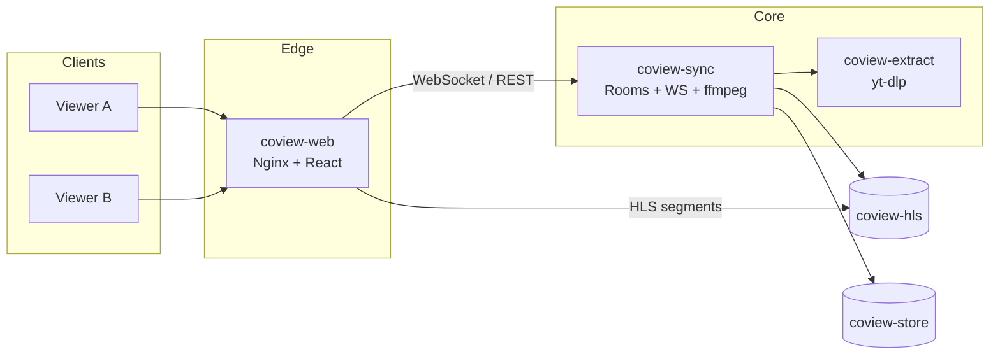

<div align="center">

# CoView

### Real-time collaborative video streaming — self-hosted watch parties

[](LICENSE)
[](services/sync)
[](apps/web)
[](deploy/stack.yml)

Create a room · Share a link · Watch in sync · Chat together  
**No SaaS lock-in** — you own the stack, data, and URLs.

[Quick start](#-quick-start) · [Architecture](#-architecture) · [Configuration](#-configuration) · [Development](#-development) · [Docs](docs/ARCHITECTURE.md)

</div>

---

## ✨ Highlights

| | |
|---|---|
| **Instant rooms** | One click → shareable URL. Guests join with a nickname — no account required. |
| **Tight sync** | Server-authoritative timeline over WebSockets; play, pause, seek, and **0.25×–2× speed** stay aligned. |
| **Rich media** | YouTube, HLS (`.m3u8`), direct files (`.mp4`, `.webm`, `.mkv`, …), and **1800+ sites** via the extract service. |
| **Social layer** | Queue, reactions, typing indicators, timestamp links in chat, optional ping sound. |
| **Host tools** | Lock controls, kick/ban, transfer host, persistent rooms, custom slugs with optional accounts. |
| **Captions** | Full YouTube caption catalog (including auto-translate) with per-viewer language choice. |
| **Hardened** | Private internal network, CSP, rate limits, SSRF guards, non-root containers. |

YouTube is the only third-party **embed**; other sources are proxied through your server so viewers are not blocked by CORS, codecs, or CDN headers.

---

## 🏗 Architecture



**Flow in plain terms**

1. Browsers hit your HTTPS reverse proxy → **coview-web** (only public-facing container).
2. The SPA opens a WebSocket to **coview-sync** for room state and chat.
3. YouTube plays in-browser; other URLs are remuxed to HLS on a shared RAM volume both sync and web mount.
4. **coview-extract** resolves page links to stream URLs (internal only).

Deep dive: **[docs/ARCHITECTURE.md](docs/ARCHITECTURE.md)** (topology, request paths, scaling notes).

---

## 📁 Repository layout

```
coview/
├── apps/web/                 React + TypeScript + Vite + Tailwind UI
│   ├── src/roomHub.ts        Session layer (socket, sync engine, players)
│   ├── src/sync/             Drift correction + YouTube / HTML5 adapters
│   └── nginx.conf            Edge proxy, CSP, /api/streams static HLS
├── services/sync/            Rust (axum + tokio): rooms, WS, ffmpeg HLS, SQLite
├── services/extract/           Python + yt-dlp: resolve URLs & subtitles
├── deploy/stack.yml          Four-service Compose stack
├── docs/ARCHITECTURE.md      System design reference
├── .env.example              Copy to .env for Compose
└── LICENSE                   MIT
```

---

## 🚀 Quick start

### Prerequisites

- Linux host with **Docker Compose v2**
- **HTTPS** reverse proxy (Nginx Proxy Manager, Traefik, Caddy, …)
- External Docker network named **`proxy`** (shared with your proxy)

### 1 · Clone & configure

```bash
git clone https://github.com/vishesh-017/coview.git
cd coview
cp .env.example .env
```

Edit `.env` — set **`PUBLIC_ORIGIN`** to your public `https://` URL.

Before going live, fill in the **controller block** in `apps/web/src/components/Privacy.tsx` (name + contact; required for GDPR-style notices).

### 2 · Build images

```bash
docker network create proxy   # skip if it already exists

docker build -t coview-sync:latest     ./services/sync
docker build -t coview-web:latest      ./apps/web
docker build -t coview-extract:latest  ./services/extract
```

### 3 · Run the stack

```bash
docker compose -f deploy/stack.yml up -d
docker compose -f deploy/stack.yml ps    # wait until all services are healthy
```

Point your reverse proxy at host **`coview-web`**, port **80** (TLS terminates at the proxy).

### Services

| Container | Network | Role |
|-----------|---------|------|
| `coview-web` | `proxy` + private | SPA, Nginx, `/api` + `/ws` proxy, serves HLS from tmpfs |
| `coview-sync` | private | Authoritative room state, WebSocket sync, ffmpeg |
| `coview-extract` | private | yt-dlp resolver (streams + subtitle metadata) |
| `coview-pot` | private | YouTube PO-token sidecar (pulled image) |

**Volumes:** `coview-hls` (tmpfs segment scratch) · `coview-store` (`/data/coview.sqlite`)

```bash
docker compose -f deploy/stack.yml logs -f coview-sync
docker compose -f deploy/stack.yml down
```

**Portainer:** build the three images on the host, paste `deploy/stack.yml` into a stack named `coview`, attach env vars, deploy.

---

## ⚙ Configuration

Copy [`.env.example`](.env.example) → `.env`. Common variables:

| Variable | Default | Description |
|----------|---------|-------------|
| `PUBLIC_ORIGIN` | `*` | Allowed browser origin(s) for CORS / cookies |
| `RESOLVER_URL` | `http://coview-extract:8080` | Extract service; empty → no site resolver / subtitles |
| `POT_PROVIDER_URL` | `http://coview-pot:4416` | Caption attestation; empty → limited auto-translate |
| `REGISTRATION_ENABLED` | `true` | Allow new account registration |
| `ALLOW_PRIVATE_URLS` | `false` | Allow LAN/NAS media URLs (SSRF risk if public) |
| `STREAMS_TMPFS_SIZE` | `2g` | RAM for HLS volume (fixed at first volume create) |
| `COOKIE_SECURE` | `true` | Set `false` only for plain-HTTP lab installs |

Extended tunables live in [`services/sync/src/config.rs`](services/sync/src/config.rs) and [`services/extract/app.py`](services/extract/app.py).

---

## 🛠 Development

**Requirements:** Rust **1.90+** (matches Docker build), **Node 22.7+**, optional **ffmpeg** for non-YouTube local tests.

```bash
# Terminal 1 — sync API on :3000
cd services/sync && cargo run

# Terminal 2 — Vite dev server (proxies /api and /ws)
cd apps/web && npm install && npm run dev
```

**Quality checks**

```bash
(cd services/sync && cargo test && cargo clippy --all-targets)
(cd apps/web && npm test && npm run typecheck && npm run lint)
python3 -m unittest discover -s services/extract -v
```

Local accounts DB: `services/sync/data/coview.sqlite` (gitignored).

---

## 🎬 Supported media

| Source | Support | Notes |
|--------|---------|-------|
| YouTube | First-class | IFrame API; lazy-loaded for privacy |
| HLS (`.m3u8`) | First-class | HLS.js + server remux |
| Direct video | First-class | ffmpeg → HLS; MKV audio transcoded to AAC |
| Vimeo, Twitch, Reddit, … | Best-effort | Via **coview-extract** (~1800 sites) |
| DRM (Netflix, etc.) | ✗ | Not supported |

---

## 🔒 Security & privacy

- Only **coview-web** is on the edge network; sync and extract have no public route.
- Strict **CSP** and security headers (see `apps/web/security-headers.conf`).
- Per-IP and per-connection **rate limits**; chat/input sanitization.
- **SSRF** protection on user-supplied URLs (optional LAN mode for homelab).
- Privacy copy in [`Privacy.tsx`](apps/web/src/components/Privacy.tsx) — customize before production.

---

## 🤝 Contributing

Issues and PRs are welcome on [github.com/vishesh-017/coview](https://github.com/vishesh-017/coview). Please run the test commands above before submitting changes.

---

## 📄 License

[MIT](LICENSE) © Vishesh Shah
