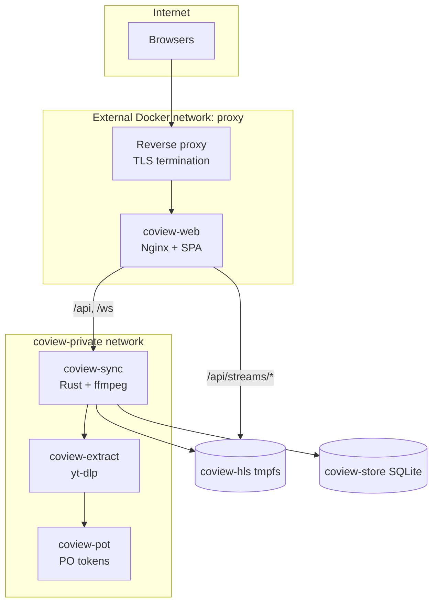

# CoView architecture

This document describes how the CoView stack fits together. For deployment steps, see the [README](../README.md).

## System context

CoView is a self-hosted **watch-together** platform. Viewers join a room URL; playback state (play/pause, position, speed, queue) is authoritative on the server and pushed over WebSockets. Media sources vary: YouTube uses the IFrame API in the browser; everything else is proxied server-side to HLS so clients share one timeline without talking to arbitrary origins.

## Container topology

Only **coview-web** attaches to the public `proxy` network. Sync, extract, and pot are reachable from other containers on `coview-private`, not from the edge.

## Request paths

| Path | Handler | Purpose |
|------|---------|---------|
| `/` | Nginx static | React SPA |
| `/ws` | Nginx → sync | JSON WebSocket protocol |
| `/api/*` | Nginx → sync | REST: rooms, auth, subtitles, health |
| `/api/streams/*` | Nginx direct | HLS segments from shared tmpfs |

## Sync service (`services/sync`)

- **In-memory rooms** — video state, queue, users, chat ring buffer, host tokens.
- **WebSocket loop** — validates intents, broadcasts snapshots, heartbeats, reconnect grace.
- **Stream worker** — one ffmpeg per active proxied room; writes HLS under `/dev/shm/streams`.
- **Optional accounts** — SQLite (`coview.sqlite`): users, sessions, registered room slugs.

Position is stored as `(current_time, last_update, rate)`; live position is extrapolated on read so pause and speed changes stay exact.

## Web app (`apps/web`)

- **RoomHub** — owns socket, `SyncEngine`, and active player adapter; updates Zustand store.
- **Players** — YouTube IFrame API vs HTML5/HLS.js for proxied streams.
- **SyncEngine** — drift correction: soft rate nudge before hard seek; buffer-aware hold when data is not ready.

## Extract service (`services/extract`)

Internal HTTP API: page URL → direct stream URLs, headers, subtitle tracks. Used by sync before ffmpeg and for caption listing. Not exposed at the edge.

## Data stores

| Store | Lifetime | Contents |
|-------|----------|----------|
| Room map (RAM) | Until room reaped | Playback, queue, presence |
| coview-hls | Per segment / room | ffmpeg HLS output |
| coview-store | Durable | Accounts and claimed `/r/slug` names |

## Security highlights

- SSRF guard on pasted URLs (optional LAN allowlist).
- Rate limits on HTTP and WebSocket paths; Nginx edge limits.
- CSP and security headers on the web tier.
- Containers run with dropped capabilities and resource caps (see `deploy/stack.yml`).

## Scaling note

Room state is process-local today. Horizontal scale would require a shared store (e.g. Redis) and pub/sub for broadcasts; sync logic is concentrated in `state.rs` and `ws.rs`.
